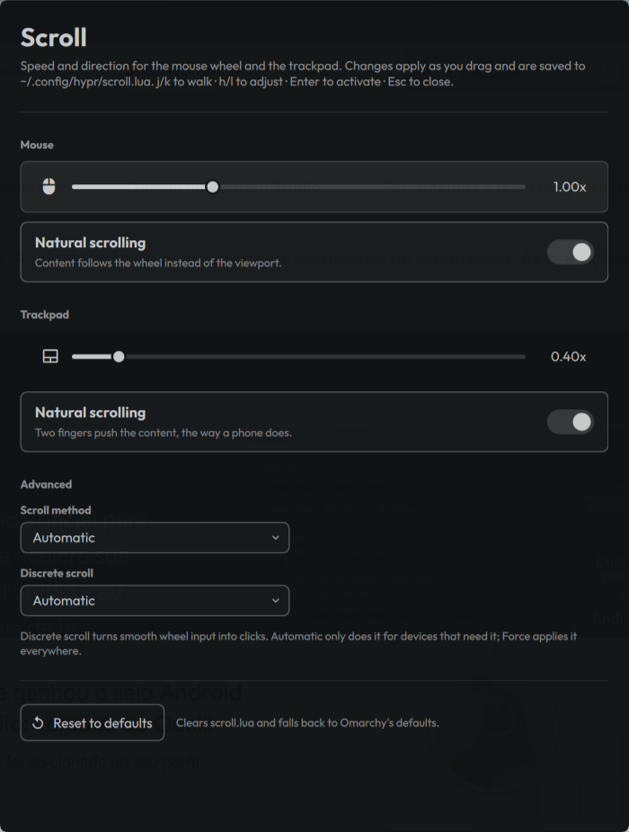

# Scroll

An Omarchy shell panel for mouse and trackpad scrolling: speed, direction,
scroll method, and discrete-scroll emulation.

Built entirely from the shell's own `qs.Ui` kit, so it follows the active
Omarchy theme, font, and spacing with no styling of its own.



## Install

```bash
omarchy plugin add https://github.com/eusener/omarchy-scroll.git --enable
```

Third-party plugins are disabled on arrival; `--enable` handles that, or run
`omarchy plugin enable eusener.scroll` later.

Open it with:

```bash
omarchy-shell shell summon eusener.scroll
```

## Two optional steps the plugin cannot do for you

A plugin is only ever cloned into place. Nothing it ships runs at install time,
and it never edits your Hyprland or menu config for these. Both are worth doing
by hand.

### 1. Stop the window from tiling

Quickshell's `FloatingWindow` is an ordinary toplevel as far as Hyprland is
concerned, so without a rule it tiles. Add to `~/.config/hypr/hyprland.lua`:

```lua
o.window(
  { class = "^org\\.quickshell$", title = "^Scroll settings$" },
  { float = true, center = true, size = { 560, 740 } }
)
```

The title is matched alongside the class so the rule leaves every other
Quickshell window alone.

### 2. Add it to the Omarchy menu

In `~/.config/omarchy/extensions/omarchy-menu.jsonc`:

```jsonc
"setup.scroll": {"icon":"󰍽","label":"Scroll","description":"Mouse and trackpad scroll speed and direction","action":"omarchy-shell shell summon eusener.scroll"},
```

It lands under **Setup**, next to the stock **Input** entry. The file
hot-reloads on save.

A keybinding works too, in `~/.config/hypr/bindings.lua`:

```lua
o.bind("SUPER + SHIFT + S", "Scroll settings", "omarchy-shell shell summon eusener.scroll")
```

Check `omarchy menu keybindings --print` first, because the combination may already be taken.

## How settings are applied and kept

Omarchy configures Hyprland in Lua, and `hyprctl keyword` refuses to touch a
non-legacy parser (*"keyword can't work with non-legacy parsers. Use eval."*).
So a live change is a one-key `hl.config()` call sent through `hyprctl eval`,
which merges into the running config.

**Nothing is written to disk until you ask for it.** Out of the box, changes are
live only and disappear on the next Hyprland reload. The panel says so and
offers a **Keep across reloads** button. Pressing it (or running
`omarchy-scroll enable`) does exactly two things:

1. writes `~/.config/hypr/scroll.lua`, a file this plugin owns, with your
   current values;
2. appends one marked line to your `~/.config/hypr/input.lua`:

   ```lua
   -- Mouse/trackpad scroll settings, managed by omarchy-scroll.
   require("hypr.scroll") -- omarchy-scroll
   ```

`scroll.lua` loads after Omarchy's defaults, so it wins. From then on, dragging a
slider previews and releasing it rewrites `scroll.lua`. The plugin never edits
any other line of your config. It also refuses to overwrite a `scroll.lua` that
it did not generate itself.

The panel holds no state of its own: every time it opens it re-reads the
effective values from `hyprctl getoption`, so it cannot drift from the
compositor.

## Command line

The backend is usable on its own:

```bash
bin/omarchy-scroll get              # current settings as JSON
bin/omarchy-scroll set pad-factor 0.75
bin/omarchy-scroll save             # write the live values to scroll.lua
bin/omarchy-scroll enable           # load scroll.lua on reload (edits input.lua)
bin/omarchy-scroll disable          # remove that line from input.lua again
bin/omarchy-scroll reset            # empty scroll.lua, back to Omarchy defaults
bin/omarchy-scroll uninstall        # disable + delete scroll.lua + reload
```

Keys: `mouse-factor`, `mouse-natural`, `pad-factor`, `pad-natural`,
`scroll-method`, `emulate-discrete`.

For a plain `omarchy-scroll` on your `PATH`:

```bash
ln -s ~/.config/omarchy/plugins/eusener.scroll/bin/omarchy-scroll ~/.local/bin/omarchy-scroll
```

## Keys

`j`/`k` walk the controls, `h`/`l` adjust the focused slider, `Enter`
activates, `Esc` closes.

## Uninstall

Undo the config changes first, while the backend is still on disk, then remove
the plugin:

```bash
~/.config/omarchy/plugins/eusener.scroll/bin/omarchy-scroll uninstall
omarchy plugin remove eusener.scroll
```

`uninstall` removes the `require` line it added to `input.lua`, deletes
`scroll.lua` (only if this plugin generated it), and reloads Hyprland so the
Omarchy defaults are back. If you skipped this and already removed the plugin,
delete those two lines from `~/.config/hypr/input.lua` and the
`~/.config/hypr/scroll.lua` file by hand.

Also remove the window rule, menu entry, or keybinding if you added them in the
optional steps above.

## Requirements and dependencies

- Omarchy with `omarchy-shell` (Quickshell). The panel uses only the shell's
  built-in `qs.Ui` and `qs.Commons` modules.
- Hyprland with the Lua config (`hyprctl eval`, `hyprctl getoption`).
- `bash`, `jq`, `grep`, `sed`. All are already dependencies of Omarchy itself.

No other packages, network access, or bundled third-party code.

## License

MIT, see [LICENSE](LICENSE). Copyright (c) 2026 Eusener Castilho. The code and
the preview image in `docs/` are original work by the author.
